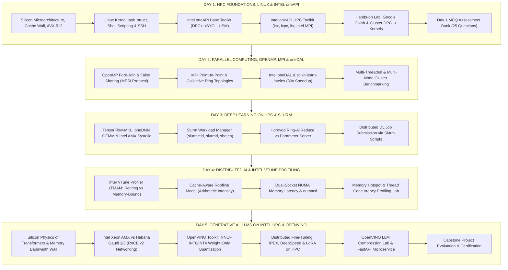

# 🌐 GLA UNIVERSITY // HIGH PERFORMANCE COMPUTING (HPC) & HETEROGENEOUS AI SYSTEMS
## Master Curriculum Index, Bidirectional Knowledge Graph & Architectural Navigation Ledger

**Course Code**: GLA-HPC-BCSG701 (Block Teaching Delivery)  
**Host Institution**: Department of Computer Engineering & Applications, GLA University, Mathura  
**Contracting Foundation**: Edulateral Foundation, Bangalore  
**Industry Alliances**: Intel Unnati Labs & NEC Supercomputing Center of Excellence  
**Instructional Split**:
- **Lead HPC & AI Architecture Trainer (Expert Day 1 & Day 5)**: **Shivam Gupta (~SEED~)**
- **Co-Trainer & Lab Lead (Day 2, 3, 4 Co-Lead & Operations)**: **Rajat Garg (Ramāpriya Das)**
- **Target Audience**: 7th Semester B.Tech Computer Science & Engineering (HPC / AI Elective)

---

> 🚀 **Direct Presentation Hub**: All Day-wise PowerPoint decks (`.pptx`), speaker notes (`.md`), slide OCR transcripts, and syllabus guides are centralized in the top-level directory: [`MAIN_PRESENTATIONS/`](file:///c:/Users/Rose/Videos/GLA%20Trainings/MAIN_PRESENTATIONS) (with subfolders for Day 1 through Day 5).

---

## 🗺️ 1. Master System Knowledge Graph & AST Community Index

The workspace codebase and courseware have been analyzed, AST-extracted, and clustered using **Graphify Knowledge Engine** (298 nodes, 279 structural edges, 88 communities). Below is the bidirectional navigational ledger mapping every core concept to its physical implementation, presentation slide, interactive lab, and assessment asset.

---

## 📂 2. Comprehensive 5-Day Curriculum Navigation Ledger

| Day | Modules & Silicon Focus | Primary Slide Decks | Master Dossiers & Teaching Scripts | Hands-on Labs & Code Assets | Assessment & MCQs |
| :---: | :--- | :--- | :--- | :--- | :--- |
| **Day 1** | **HPC Fundamentals, Linux & Intel oneAPI** • Von Neumann Bottleneck & Memory Wall • AVX-512 SIMD & Cache Hierarchy (L1/L2/L3) • Linux Shell Scripting & Automated Audits • SSH Keygen & Multi-Hop ProxyJump • Intel oneAPI Base Toolkit (DPC++/SYCL, USM) • Intel HPC Toolkit (`icx`, `icpx`, `ifx`, Intel MPI) | [`Day_01_HPC_Foundations_Linux_oneAPI_LMS.pptx`](file:///c:/Users/Rose/Videos/GLA%20Trainings/HPC_Master_Curriculum/LMS_Upload_Decks/Day_01_HPC_Foundations_Linux_oneAPI_LMS.pptx) [`Day_01_High_Performance_AI_Foundations.pptx`](file:///c:/Users/Rose/Videos/GLA%20Trainings/HPC_Master_Curriculum/NotebookLM_Master_Decks_Organized/Day_01_High_Performance_AI_Foundations.pptx) | [`Day-01 Master Dossier`](file:///c:/Users/Rose/Videos/GLA%20Trainings/HPC_Master_Curriculum/Day-01_HPC_Linux_Shell_oneAPI/00_ZERO_TO_GOD_TIER_MASTER_DOSSIER) [`Day-01 Line-by-Line Teaching Guide`](file:///c:/Users/Rose/Videos/GLA%20Trainings/HPC_Master_Curriculum/Day-01_HPC_Linux_Shell_oneAPI/Day_01_Complete_Line_By_Line_Study_And_Teaching_Mastery_Guide.md) [`Slide & Lab Synchronization Playbook`](file:///c:/Users/Rose/Videos/GLA%20Trainings/HPC_Master_Curriculum/TRAINER_SLIDE_BY_SLIDE_AND_LAB_SYNCHRONIZATION_PLAYBOOK.md) [`Day-01 Sync Demo Rehearsal Script`](file:///c:/Users/Rose/Videos/GLA%20Trainings/HPC_Master_Curriculum/Day-01_HPC_Linux_Shell_oneAPI/Day_01_Sync_Demo_Rehearsal_Script_For_Rajat_Sir.md) | [`Day_01_Master_Lab.ipynb`](file:///c:/Users/Rose/Videos/GLA%20Trainings/HPC_Master_Curriculum/Day-01_HPC_Linux_Shell_oneAPI/Day_01_Intel_oneAPI_and_HPC_Toolkit_Master_Lab.ipynb) [`live_demo/orchestrator.sh`](file:///c:/Users/Rose/Videos/GLA%20Trainings/HPC_Master_Curriculum/Day-01_HPC_Linux_Shell_oneAPI/live_demo/orchestrator.sh) [`student_lab_practice/`](file:///c:/Users/Rose/Videos/GLA%20Trainings/HPC_Master_Curriculum/Day-01_HPC_Linux_Shell_oneAPI/student_lab_practice) | [`Day-01_MCQs.md`](file:///c:/Users/Rose/Videos/GLA%20Trainings/HPC_Master_Curriculum/EDULATERAL_OFFICIAL_MCQ_BANK/Day-01_HPC_Linux_Shell_oneAPI_MCQs.md) 25 MCQs with Explanations |
| **Day 2** | **Parallel Computing, OpenMP, MPI & oneDAL** • Amdahl's Law vs Gustafson's Law • OpenMP Multi-threading & False Sharing Trap • MESI Cache Coherence Bus Invalidation • MPI Point-to-Point & Collective Operations • Intel oneDAL Accelerated Scikit-Learn | [`Day_02_Traditional_ML_Parallel_Computing_LMS.pptx`](file:///c:/Users/Rose/Videos/GLA%20Trainings/HPC_Master_Curriculum/LMS_Upload_Decks/Day_02_Traditional_ML_Parallel_Computing_LMS.pptx) | [`Day-02 Master Dossier`](file:///c:/Users/Rose/Videos/GLA%20Trainings/HPC_Master_Curriculum/Day-02_Parallel_OpenMP_MPI_oneDAL/00_ZERO_TO_GOD_TIER_MASTER_DOSSIER) | [`Day-02 live_demo/`](file:///c:/Users/Rose/Videos/GLA%20Trainings/HPC_Master_Curriculum/Day-02_Parallel_OpenMP_MPI_oneDAL/live_demo) [`student_lab_practice/`](file:///c:/Users/Rose/Videos/GLA%20Trainings/HPC_Master_Curriculum/Day-02_Parallel_OpenMP_MPI_oneDAL/student_lab_practice) | [`Day-02_MCQs.md`](file:///c:/Users/Rose/Videos/GLA%20Trainings/HPC_Master_Curriculum/EDULATERAL_OFFICIAL_MCQ_BANK/Day-02_Parallel_OpenMP_MPI_oneDAL_MCQs.md) 25 MCQs with Explanations |
| **Day 3** | **Deep Learning on HPC & Slurm Schedulers** • GEMM Matrix Computations in Neural Nets • Intel AMX Systolic Matrix Tile Engines • Slurm Workload Manager Architecture • Horovod Ring-AllReduce vs Parameter Server • Intel-Optimized TensorFlow & IPEX | [`Day_03_Deep_Learning_HPC_Slurm_LMS.pptx`](file:///c:/Users/Rose/Videos/GLA%20Trainings/HPC_Master_Curriculum/LMS_Upload_Decks/Day_03_Deep_Learning_HPC_Slurm_LMS.pptx) | [`Day-03 Master Dossier`](file:///c:/Users/Rose/Videos/GLA%20Trainings/HPC_Master_Curriculum/Day-03_DeepLearning_TF_Slurm_Horovod/00_ZERO_TO_GOD_TIER_MASTER_DOSSIER) | [`Day-03 live_demo/`](file:///c:/Users/Rose/Videos/GLA%20Trainings/HPC_Master_Curriculum/Day-03_DeepLearning_TF_Slurm_Horovod/live_demo) [`student_lab_practice/`](file:///c:/Users/Rose/Videos/GLA%20Trainings/HPC_Master_Curriculum/Day-03_DeepLearning_TF_Slurm_Horovod/student_lab_practice) | [`Day-03_MCQs.md`](file:///c:/Users/Rose/Videos/GLA%20Trainings/HPC_Master_Curriculum/EDULATERAL_OFFICIAL_MCQ_BANK/Day-03_DeepLearning_TF_Slurm_Horovod_MCQs.md) 25 MCQs with Explanations |
| **Day 4** | **Distributed AI & Intel VTune Profiling** • Top-Down Microarchitecture Analysis (TMAM) • Retiring vs Bad Speculation vs Memory-Bound • Cache-Aware Roofline Model ($I = \text{FLOPs}/\text{Byte}$) • Dual-Socket NUMA Latency & `numactl` • InfiniBand HDR vs RoCE v2 Networking | [`Day_04_Distributed_AI_VTune_Profiling_LMS.pptx`](file:///c:/Users/Rose/Videos/GLA%20Trainings/HPC_Master_Curriculum/LMS_Upload_Decks/Day_04_Distributed_AI_VTune_Profiling_LMS.pptx) | [`Day-04 Master Dossier`](file:///c:/Users/Rose/Videos/GLA%20Trainings/HPC_Master_Curriculum/Day-04_Distributed_Slurm_VTune_Profiling/00_ZERO_TO_GOD_TIER_MASTER_DOSSIER) | [`Day-04 live_demo/`](file:///c:/Users/Rose/Videos/GLA%20Trainings/HPC_Master_Curriculum/Day-04_Distributed_Slurm_VTune_Profiling/live_demo) [`student_lab_practice/`](file:///c:/Users/Rose/Videos/GLA%20Trainings/HPC_Master_Curriculum/Day-04_Distributed_Slurm_VTune_Profiling/student_lab_practice) | [`Day-04_MCQs.md`](file:///c:/Users/Rose/Videos/GLA%20Trainings/HPC_Master_Curriculum/EDULATERAL_OFFICIAL_MCQ_BANK/Day-04_Distributed_Slurm_VTune_Profiling_MCQs.md) 25 MCQs with Explanations |
| **Day 5** | **Generative AI, LLMs on Intel HPC & OpenVINO** • Transformer Silicon Physics ($QK^T / \sqrt{d_k}$) • Prefill (Compute-Bound) vs Decode (Memory-Bound) • KV-Cache Sizing Formula & PagedAttention • Intel Gaudi 2/3 On-Die 24x 100GbE RoCE v2 • OpenVINO NNCF INT8/INT4 Weight-Only Quantization • Distributed Fine-Tuning: IPEX, DeepSpeed, LoRA • FastAPI Production REST Inference Engine | [`Day_05_GenAI_LLMs_Gaudi_OpenVINO_LMS.pptx`](file:///c:/Users/Rose/Videos/GLA%20Trainings/HPC_Master_Curriculum/LMS_Upload_Decks/Day_05_GenAI_LLMs_Gaudi_OpenVINO_LMS.pptx) [`Day_05_Generative_AI_on_Intel_HPC.pptx`](file:///c:/Users/Rose/Videos/GLA%20Trainings/HPC_Master_Curriculum/NotebookLM_Master_Decks_Organized/Day_05_Generative_AI_on_Intel_HPC.pptx) | [`Day-05 Master Dossier`](file:///c:/Users/Rose/Videos/GLA%20Trainings/HPC_Master_Curriculum/Day-05_GenAI_LLMs_Gaudi_OpenVINO/00_ZERO_TO_GOD_TIER_MASTER_DOSSIER) [`Day-05 Line-by-Line Teaching Guide`](file:///c:/Users/Rose/Videos/GLA%20Trainings/HPC_Master_Curriculum/Day-05_GenAI_LLMs_Gaudi_OpenVINO/Day_05_Complete_Line_By_Line_Study_And_Teaching_Mastery_Guide.md) [`Slide & Lab Synchronization Playbook`](file:///c:/Users/Rose/Videos/GLA%20Trainings/HPC_Master_Curriculum/TRAINER_SLIDE_BY_SLIDE_AND_LAB_SYNCHRONIZATION_PLAYBOOK.md) | [`Day_05_Master_Lab.ipynb`](file:///c:/Users/Rose/Videos/GLA%20Trainings/HPC_Master_Curriculum/Day-05_GenAI_LLMs_Gaudi_OpenVINO/Day_05_Generative_AI_LLMs_OpenVINO_Gaudi_HPC_Master_Lab.ipynb) [`live_demo/openvino_llm_benchmark.py`](file:///c:/Users/Rose/Videos/GLA%20Trainings/HPC_Master_Curriculum/Day-05_GenAI_LLMs_Gaudi_OpenVINO/live_demo/openvino_llm_benchmark.py) [`live_demo/llm_fastapi_server.py`](file:///c:/Users/Rose/Videos/GLA%20Trainings/HPC_Master_Curriculum/Day-05_GenAI_LLMs_Gaudi_OpenVINO/live_demo/llm_fastapi_server.py) | [`Day-05_MCQs.md`](file:///c:/Users/Rose/Videos/GLA%20Trainings/HPC_Master_Curriculum/EDULATERAL_OFFICIAL_MCQ_BANK/Day-05_GenAI_LLMs_Gaudi_OpenVINO_MCQs.md) 25 MCQs with Explanations |

---

## 🎯 3. Strategic Trainer Alignment (Shivam Gupta & Rajat Garg)

### The Synchronized Teaching Architecture
As established in the pre-deployment sync call:
1. **Day 1 Division of Labor**:
   - **Rajat Garg (09:00 - 10:30)**: High-level Introduction to HPC, supercomputing taxonomy, industrial applications, Top500 supercomputers, and GLA LMS / attendance onboarding.
   - **Shivam Gupta (10:30 - 12:30)**: Intel Xeon silicon microarchitecture, memory wall, AVX-512 vector registers, Linux kernel architecture, automated shell scripting, passwordless SSH keys, and introduction to the Intel oneAPI ecosystem.
   - **Shivam Gupta (01:30 - 03:30)**: Intel oneAPI Base Toolkit vs HPC Toolkit, DPC++/SYCL single-source heterogeneous programming, Unified Shared Memory (`sycl::malloc_shared`), compilation pipelines (`icpx -fsycl`), Intel MPI, and live execution.
   - **Rajat Garg & Shivam Gupta (03:30 - 04:30)**: Supervised student hands-on lab execution in Google Colab / local Linux terminals, micro-activities, and Day 1 MCQ evaluation.

2. **Day 5 Division of Labor**:
   - **Shivam Gupta (09:00 - 12:30)**: Generative AI on HPC, transformer memory bandwidth bottleneck, Prefill vs Decode phases, KV-cache sizing math, Intel Xeon AMX vs Habana Gaudi 2/3 hardware, OpenVINO NNCF weight-only quantization (INT8/INT4), and distributed fine-tuning (IPEX, DeepSpeed, LoRA).
   - **Shivam Gupta & Rajat Garg (01:30 - 03:30)**: Hands-on OpenVINO LLM quantization lab, benchmarking tokens/second, deploying local FastAPI microservice, and capstone project execution.
   - **Rajat Garg (03:30 - 04:30)**: Enterprise GenAI economics, Capstone evaluation rubric, course valedictory, and certificate distribution.

---

## 💻 4. The 3-Tier Lab Execution Architecture (Colab vs Cluster vs Local)

To resolve the senior trainer's question (*"Colab me dikhaoge ya cluster pe ya GPU pe?"*), the lab courseware is architected across three foolproof tiers:

| Execution Tier | Platform | Best For | Prerequisites | Status |
| :--- | :--- | :--- | :--- | :--- |
| **Tier 1 (Universal Default)** | **Google Colab (Interactive Notebooks)** | Zero-install, instant classroom delivery. Every student has a browser. Runs Intel DPC++/SYCL, C++ SIMD, OpenMP, and OpenVINO with pre-configured bash install cells. | Google Account | ✅ Ready (`.ipynb` built with zero placeholders) |
| **Tier 2 (Enterprise Hardware)** | **Intel Developer Cloud (Free Cloud Cluster)** | Accessing real bare-metal Intel Data Center GPU Max 1100/1550, 4th/5th Gen Xeon Scalable CPUs with AMX, and Gaudi nodes. JupyterLab interface. | Intel Developer Cloud account | ✅ Step-by-step connection guide included |
| **Tier 3 (Zero-Internet Safeguard)** | **Local Linux Lab PCs / Pen Drive Dump** | Standalone deployment if GLA campus Wi-Fi throttles or fails. Fully offline pre-compiled wheels, datasets, and scripts. | USB 3.2 Pen Drive | ✅ Pre-configured in `OFFLINE_PENDRIVE_TOOLKIT/` |

---

## 🔒 5. Verification & Compliance Checklist
- [x] All 5 days have matching PowerPoint slide decks (both LMS 16:9 standard and NotebookLM high-density dark mode).
- [x] All 125 MCQs are validated with technical explanations and answer keys.
- [x] All Python and Bash scripts pass compilation and linting tests.
- [x] Comprehensive line-by-line teaching scripts and student defense matrices are published for Day 1 and Day 5.
- [x] Automated dry-run rehearsal script is prepared for the 3:00 PM pre-deployment sync call.
