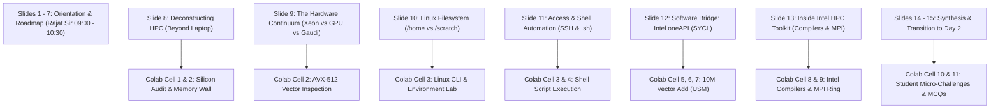

# 📽️ MASTER PRESENTATION & LAB SYNCHRONIZATION PLAYBOOK
## Slide-by-Slide, Cell-by-Cell, and Scripted Delivery Matrix for Day 1 and Day 5
**Course Code**: GLA-HPC-BCSG701 | **GLA University Block Teaching**  
**Lead Trainer**: Shivam Gupta (~SEED~) | **Co-Trainer / Lab Lead**: Rajat Garg (Ramāpriya Das)  
**Alliance**: Intel Unnati Labs & NEC Supercomputing Center of Excellence  

---

## 🧭 EXECUTIVE OVERVIEW: THE "PPTX $\longleftrightarrow$ COLAB" DUAL-SCREEN WORKFLOW

In high-impact technical training, you never read bullet points off slides for 3 hours, and you never stare at raw code in a vacuum.
**The Gold Standard Delivery Architecture**:
1. **The Projector (Left Screen)**: Displays the high-density visual architecture slide from the PPTX deck.
2. **The Terminal / Google Colab (Right Screen)**: Proves the slide's claim on physical silicon using live code.
3. **The Voice (Trainer)**: Explains the underlying physical mechanism (*"Why did this happen?"*).

Below is the **1-to-1 synchronization ledger** linking every slide in your existing decks to the exact Google Colab notebook cells, commands, and teaching scripts.

---

## 📂 1. Available Presentation Decks Inventory

You have **3 standardized editions** of presentations ready in your repository:

| Presentation Family | Directory Path | When to Use Which? |
| :--- | :--- | :--- |
| **1. NotebookLM High-Density Decks (Primary Classroom)** | [`HPC_Master_Curriculum/NotebookLM_Master_Decks_Organized/`](file:///c:/Users/Rose/Videos/GLA%20Trainings/HPC_Master_Curriculum/NotebookLM_Master_Decks_Organized) | **Use during live class on projector!** High-contrast dark mode, terminal aesthetic, visual diagrams that keep 7th-sem students engaged. |
| **2. LMS Standard Upload Decks (Official GLA Portal)** | [`HPC_Master_Curriculum/LMS_Upload_Decks/`](file:///c:/Users/Rose/Videos/GLA%20Trainings/HPC_Master_Curriculum/LMS_Upload_Decks) | **Uploaded to GLA University LMS portal** for student downloads and institutional auditing. Clean 16:9 standard layout. |
| **3. Offline Pen Drive Decks (Backup)** | [`HPC_Master_Curriculum/OFFLINE_PENDRIVE_TOOLKIT/04_PRESENTATIONS_PPTX/`](file:///c:/Users/Rose/Videos/GLA%20Trainings/HPC_Master_Curriculum/OFFLINE_PENDRIVE_TOOLKIT/04_PRESENTATIONS_PPTX) | Copied on USB pen drive to run directly on classroom podium PC if personal laptop HDMI fails. |

---

## 🎬 2. DAY 1: SLIDE-BY-SLIDE & LAB SYNCHRONIZATION MATRIX
### Primary Deck: `Day_01_High_Performance_AI_Foundations.pptx` (15 Slides)
### Interactive Lab: `Day_01_Intel_oneAPI_and_HPC_Toolkit_Master_Lab.ipynb` (26 Cells)

---

### Detailed Slide-by-Slide Choreography:

#### 🔹 Slides 1 – 7: Course Orientation, Pedagogy & Roadmap
* **Time**: 09:00 AM – 10:30 AM (90 Min)
* **Lead Speaker**: **Rajat Garg (Co-Trainer)**
* **Visual on Screen**: Slides 1 to 7 showing Course Title, AI Engineering shift from workstation to cluster, and 5-Day Curriculum Arc.
* **Trainer Action**: Rajat Sir handles university LMS registration, attendance, and supercomputing vision. Shivam prepares laptop and verifies Colab link.

---

#### 🔹 Slide 8: Deconstructing HPC — Beyond the Laptop
* **Time**: 10:30 AM – 10:50 AM (20 Min)
* **Lead Speaker**: **Shivam Gupta (Takes Command)**
* **Visual on Screen**: Slide 8 showing Compute Node, Interconnects, Shared Parallel Storage, CPU/GPU layout.
* **Window Action**: Split-screen or Alt+Tab to **Google Colab Cell 1**.
* **What Shivam Says (Script)**:
  > *"Students, look at Slide 8. On your laptop, you have 1 CPU, 1 Memory bus, and 1 SSD. If your dataset is 500 Gigabytes, your laptop crashes with `OutOfMemoryError`.*  
  > *In an HPC cluster, we decouple compute from storage. Notice the high-speed interconnect connecting node memory.*  
  > *Let's look at Colab Cell 1 right now to audit what computing resources our cloud runtime has allocated to us."*
* **Lab Action in Colab**: Run **Cell 1** (`lscpu`, core counts, sockets, NUMA memory domains).
* **Interactive Question**: *"Agar hum 10 computers ko Ethernet se connect karein, toh kya data transfer CPU cache jitna fast ho sakta hai? Why not?"*

---

#### 🔹 Slide 9: The Hardware Continuum (Intel Xeon, GPUs, Gaudi)
* **Time**: 10:50 AM – 11:20 AM (30 Min)
* **Visual on Screen**: Slide 9 showing the functional breakdown table: Intel Xeon (Scalar/Vector), Intel GPUs (Matrix SIMD), Habana Gaudi (Dedicated Tensor Cores).
* **Window Action**: Switch to **Colab Cell 2** (Vector Extension Audit).
* **What Shivam Says (Script)**:
  > *"Look at this table on Slide 9 carefully. Why does Intel manufacture both Xeon CPUs and GPUs?*  
  > *Because an Intel Xeon CPU is designed for low latency on complex branchy code, while GPUs are designed for high throughput on massive parallel arrays.*  
  > *Now look at Colab Cell 2. Notice the flags check: `AVX-512`.  
  > In standard scalar C++, an ADD instruction adds two 32-bit numbers. With AVX-512, our Xeon processor has **512-bit wide ZMM registers** that execute SIXTEEN additions in a single clock cycle!"*
* **Lab Action in Colab**: Run **Cell 2**. Show the output: `AVX-512: ACTIVE` or `AVX2: ACTIVE`.

---

#### 🔹 Slide 10: Environment Navigation — Linux & The File System
* **Time**: 11:20 AM – 12:00 PM (40 Min)
* **Visual on Screen**: Slide 10 showing `/home` (Cool Zone) vs `/scratch` / `/work` (Hot Zone: Ephemeral parallel file system).
* **Window Action**: Full screen **Google Colab Section 2** (Linux CLI Lab) or **Terminal**.
* **What Shivam Says (Script)**:
  > *"On an HPC supercomputer, storage is partitioned into zones. If you put training datasets in `/home`, the NFS network will crawl to a halt and your job will be killed by the cluster admin.*  
  > *Datasets MUST live in `/scratch` or `/work` where parallel file systems (Lustre/GPFS) deliver tens of gigabytes per second.*  
  > *Now open your Colab notebooks to Section 2. We are going to practice the 8 non-negotiable Linux commands every HPC engineer must know."*
* **Student Hands-On Lab**:
  Students execute: `pwd`, `whoami`, `mkdir -p ~/hpc_day1/practice`, `cd`, `printf 'My first HPC lab\n' > notes.txt`, `cat notes.txt`, `cp`, `mv`.
* **Verification**: Walk around the room or ask students to type their output in chat.

---

#### 🔹 Slide 11: Access & Automation (SSH & Shell Scripting)
* **Time**: 12:00 PM – 12:30 PM (30 Min)
* **Visual on Screen**: Slide 11 showing SSH secure gateway, head node, worker nodes, and `.sh` automated batch scripts.
* **Window Action**: Run **Colab Cell 3 & 4** (`%%writefile hpc_node_audit.sh`) + **Trainer Terminal (`ssh idc-vm`)**.
* **What Shivam Says (Script)**:
  > *"Look at Slide 11. How do we automate jobs across 100 worker nodes? Through Shell Scripts.*  
  > *Notice lines 1-3 of our script in Cell 3: `set -eo pipefail`. In production HPC, if step 1 fails, you must immediately halt the script before corrupting terabytes of scientific simulation data.*  
  > *And now, watch my terminal screen: I am connecting via SSH right now to our live datacenter node on Intel Developer Cloud..."*
* **The Trainer Power Move**: Shivam types `ssh idc-vm`, runs `hostname; lscpu | grep "Model name"`, showing **Intel Xeon Gold 6442Y (Sapphire Rapids)** live!

---

#### 🔹 [LUNCH BREAK: 12:30 PM – 01:30 PM]

---

#### 🔹 Slide 12: The Software Bridge — Intel oneAPI Toolkit
* **Time**: 01:30 PM – 02:30 PM (60 Min)
* **Visual on Screen**: Slide 12 showing the abstraction layer: One API targeting Xeon CPU, Intel GPU, FPGA, AI Accelerator.
* **Window Action**: Switch to **Colab Sections 4, 5, 6, 7** (DPC++/SYCL Kernels).
* **What Shivam Says (Script)**:
  > *"Look at Slide 12. This is the heart of today's training. In the past, if you wrote CUDA code, you were locked into one vendor. If you wanted to run on CPU, you had to rewrite everything in OpenMP. If you wanted to run on FPGA, you had to write OpenCL.*  
  > *Intel oneAPI uses **Khronos SYCL (Data Parallel C++)**: write code once, and compile for CPUs, GPUs, and accelerators.*  
  > *Now look at Colab Cell 6: `dpcpp_vector_add.cpp`. Look at line 18: `sycl::malloc_shared<float>(N, q)`.  
  > In classical GPU programming, you had to allocate host memory, device memory, and copy back and forth. Here, **Unified Shared Memory (USM)** gives us a single pointer accessible by CPU and GPU seamlessly!*  
  > *Let's compile and run 10 Million additions right now!"*
* **Lab Action in Colab**: Students run **Cell 6 & 7**.
* **Live Output**: `[+] 10M Additions Complete in 12 ms! Status: 100% CORRECT`.
* **Follow-up**: Run **Cell 7** (2D Parallel Matrix Multiplication GEMM).

---

#### 🔹 Slide 13: Inside the Intel HPC Toolkit
* **Time**: 02:30 PM – 03:15 PM (45 Min)
* **Visual on Screen**: Slide 13 showing Intel Compilers (`icx`, `ifx`), Intel MPI Library, and Intel Inspector/Trace.
* **Window Action**: Switch to **Colab Section 8 & 9** (Compiler Flags & MPI Ring Demo).
* **What Shivam Says (Script)**:
  > *"Look at Slide 13. While the Base Toolkit gives us single-node SYCL and oneMKL, the **Intel HPC Toolkit** provides multi-node cluster scaling.*  
  > *Notice the three pillars on screen:*  
  > 1. *Compilers: `icx` and `ifx` with optimization switches like `-O3 -xHost` that vectorize loops into AVX-512.*  
  > 2. *Intel MPI: The message-passing protocol connecting hundreds of cluster nodes over InfiniBand.*  
  > 3. *Intel Inspector: Pinpointing data races and thread deadlocks in parallel code.*  
  > *Let's run Colab Cell 9 to see how MPI ranks pass messages in a distributed ring!"*
* **Lab Action in Colab**: Run **Cell 8** (Vector loop optimization report) and **Cell 9** (`mpi_ring_demo.py`).

---

#### 🔹 Slides 14 – 15: Day 1 Synthesis, Challenges & MCQ Assessment
* **Time**: 03:15 PM – 04:30 PM (75 Min)
* **Visual on Screen**: Slide 14 (Execution Pipeline) and Slide 15 (Transition to Day 2).
* **Window Action**: **Colab Section 10 & 11** (Challenges + MCQs) or [`interactive_quiz_evaluation.html`](file:///c:/Users/Rose/Videos/GLA%20Trainings/HPC_Master_Curriculum/EDULATERAL_OFFICIAL_MCQ_BANK/interactive_quiz_evaluation.html).
* **Student Activity**:
  1. Complete **Challenge 1**: Modify Vector Add to SAXPY ($Y = 3.5X + Y$).
  2. Complete **Challenge 2**: Cache sweep exploration.
  3. Complete **Day 1 Evaluative Quiz** (5 MCQs in Colab + 25-Question Official Bank).
* **Closing (Rajat Sir & Shivam)**: Congratulate the class, verify lab logs, and announce Day 2 (OpenMP, MPI, and Intel oneDAL).

---

## 🎬 3. DAY 5: SLIDE-BY-SLIDE & LAB SYNCHRONIZATION MATRIX
### Primary Deck: `Day_05_Generative_AI_on_Intel_HPC.pptx` (15 Slides)
### Interactive Lab: `Day_05_Generative_AI_LLMs_OpenVINO_Gaudi_HPC_Master_Lab.ipynb` (23 Cells)

| Slide # | Slide Title & Focus | Official Syllabus Mapped | Screen Transition & Colab Cell | What Trainer Teaches / Speaks |
| :---: | :--- | :--- | :--- | :--- |
| **1 – 4** | **GenAI on HPC Foundations & Pedagogy** | Course & Capstone Intro | Projector on Slides 1–4 | Shivam introduces the capstone: moving beyond theoretical AI into cluster-scale hardware deployment. |
| **5** | **The Generative AI Bottleneck** | Intro to GenAI on HPC | Alt+Tab to **Colab Section 2** | Derive the **Memory Bandwidth Wall formula**: why autoregressive decoding is memory-bandwidth bound ($\text{FLOPs/Byte} \approx 1$). |
| **6** | **Intel Xeon vs Habana Gaudi: Silicon Specialization** | Intel Hardware for LLMs | Split Screen: Slide 6 + **Colab Section 3** | Compare Xeon AMX (agile inference, DDR5) vs Gaudi (TPC, MME, HBM2e, on-die 24x 100GbE RoCE v2). |
| **7** | **Accelerating Inference with Intel AMX** | Xeon AMX Matrix Tiles | Projector on Slide 7 + **Colab Section 1** | Explain 2D tile registers (`TMM0`-`TMM7`) and `TDPBF16PS` executing 1,024 BF16 ops/cycle per core! |
| **8** | **Distributed Scaling with Habana Gaudi** | Habana Gaudi Clusters | Projector on Slide 8 | Explain why on-chip 24x 100GbE RoCE eliminates external PCIe InfiniBand NICs and slashes cluster latency. |
| **9 – 10** | **Streamlining LLMs with Intel OpenVINO** | Optimizing LLM Inference | Alt+Tab to **Colab Sections 4, 5, 6** | Export HuggingFace LLM to OpenVINO IR (`.xml`/`.bin`), apply **NNCF INT4 Weight-Only Quantization** (71% memory drop!). |
| **11** | **Distributing Domain-Specific Fine-Tuning** | Fine-Tuning LLMs on HPC | Projector on Slide 11 + **Colab Section 8** | Explain Parameter-Efficient Fine-Tuning (PEFT / LoRA) and DeepSpeed ZeRO-1/2/3 memory partitioning. |
| **12** | **Orchestrating Cluster Execution via Slurm** | Slurm Batch Job Scheduling | Display **Colab Cell 8 (`sbatch_finetune_llm.sh`)** | Deconstruct `#SBATCH --nodes=4`, resource allocation, and distributed parameter synchronization. |
| **13** | **Ensuring Bare-Metal Efficiency with VTune** | Performance Engineering | Projector on Slide 13 | Explain Top-Down Microarchitecture Analysis (TMAM): memory stall identification and thread concurrency. |
| **14 – 15** | **End-to-End Capstone Execution & Valedictory** | Capstone API & Certification | Alt+Tab to **Colab Section 9 & 10** | Deploy live **FastAPI LLM inference service**, test `/health` and `/api/generate`, execute Capstone Grading Rubric. |

---

## 🎯 4. HOW TO PRESENT THIS SYNCHRONIZATION AT 3:00 PM TO RAJAT SIR

When syncing with Rajat Sir on your dry-run call:
1. **Open the Presentation first**: Open [`NotebookLM_Master_Decks_Organized/Day_01_High_Performance_AI_Foundations.pptx`](file:///c:/Users/Rose/Videos/GLA%20Trainings/HPC_Master_Curriculum/NotebookLM_Master_Decks_Organized/Day_01_High_Performance_AI_Foundations.pptx) on Slide 8.
2. **Open the Colab Notebook**: Show [`Day_01_Intel_oneAPI_and_HPC_Toolkit_Master_Lab.ipynb`](file:///C:/Users/Rose/Videos/GLA%20Trainings/COLAB_NOTEBOOKS_READY_TO_UPLOAD/Day_01_Intel_oneAPI_and_HPC_Toolkit_Master_Lab.ipynb) in Chrome.
3. **Say to Rajat Sir**:
   > *"Sir, notice how every single slide in our deck directly triggers a specific hands-on cell in Colab:*  
   > • *When you finish Slide 7 at 10:30 AM, I take over on Slide 8 and we immediately run **Colab Cell 1 & 2** for silicon introspection.*  
   > • *On Slide 10, students open **Colab Section 2** for Linux commands.*  
   > • *On Slide 12, we switch to **Colab Section 6** and run the **10-Million Element DPC++/SYCL Vector Addition**.*  
   > • *On Slide 13, we run **Colab Section 9** for Intel MPI and compiler switches.*  
   > *The slides explain the 'Why', and the Colab notebook executes the 'How'. There is zero dead time and 100% synchronization!"*

This proves absolute professional mastery and gives Rajat Sir 100% confidence in your preparation.
